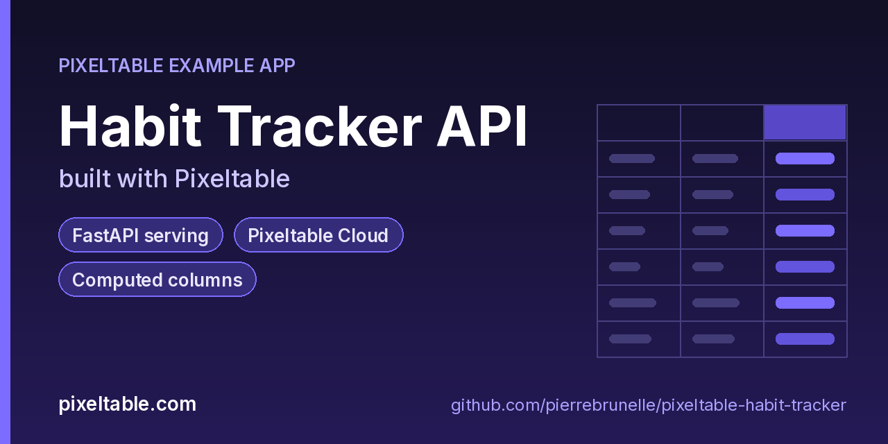

<!-- pixeltable-example-app: 20260924-habit-tracker -->
# Habit Tracker API built with Pixeltable



[](https://codespaces.new/pierrebrunelle/pixeltable-habit-tracker?quickstart=1)
[](https://pixeltable.com)
[](https://pypi.org/project/pixeltable/)
[](https://github.com/pixeltable/pixeltable)
[](LICENSE)

Track habits and streaks with a REST API in a few dozen lines of Python. Each habit has a category and a streak length; Pixeltable turns the streak into a human label ("getting started", "on a roll", "unstoppable") with a **computed column**, so check-ins via `POST /habits/update` immediately return the new label. The same project deploys to **Pixeltable Cloud** with `pxt db update` and `pxt service update`, with no code changes.

[Pixeltable](https://pixeltable.com) is open-source, Python-native **multimodal AI data infrastructure**: tables, incremental computed columns, UDFs, indexes and serving in one library, running locally or on Pixeltable Cloud.

> ⭐ **Like this example?** Star [pixeltable/pixeltable](https://github.com/pixeltable/pixeltable) on GitHub. It helps other developers find it.

## What this example shows

- **FastAPI serving**: one `FastAPIRouter` turns tables and `@pxt.query` functions into typed REST routes (insert, update, delete, compute and query) with OpenAPI docs
- **Pixeltable Cloud lifecycle** from the `pxt` CLI (`db`, `schema`, `service`)
- **Incremental computed columns** powered by plain Python UDFs (`@pxt.udf`)
- **Importable UDF module**: UDFs live in `udfs.py`; tables, queries and routes live together in `app.py` (Pixeltable resolves UDFs by module path)
- **`pixeltable.toml`** declares a local database and a **Pixeltable Cloud** database, so the same code deploys with `pxt db update`

## Local first, then the cloud

Everything runs locally against an embedded Pixeltable catalog. When you're ready to share it, the [Pixeltable Cloud](https://pixeltable.com) section below deploys the same `app.py`. `pixeltable.toml` already carries a second database entry with cpu/memory/disk sizing, so all you change is the placeholder URI. Hosted routes require an API key (`X-api-key`), and the local ones don't.

## What's inside

| File | What it is |
|------|------------|
| `.devcontainer/devcontainer.json` | GitHub Codespaces / Dev Container config: Python 3.12, installs `requirements.txt`, forwards port 8000 |
| `.github/social-preview.png` | Social preview image (1280x640) |
| `CITATION.cff` | Citation metadata (authors, license, release date, keywords) |
| `app.py` | The app: tables declared as Python classes, `@pxt.query` functions, and the `FastAPIRouter` routes |
| `client_demo.py` | Create a habit, check in a few times and list habits by category through the API |
| `pixeltable.toml` | Project config: the local database plus a Pixeltable Cloud database (sizing, deploy excludes) |
| `seed.py` | Seed a few habits |
| `udfs.py` | Pixeltable UDFs (`@pxt.udf`) in their own importable module, imported by `app.py` |
| `requirements.txt` / `pyproject.toml` | Dependencies (`pixeltable[serve]>=0.7.14`) |

**Tables**

| Table | Stored columns | Computed columns |
|-------|---------|------------------|
| `habits` | `name`, `category`, `streak_days`, `notes` | `id`, `label`, `name_upper`, `name_blurb` |

**API routes** (service `habits_api`)

| Method | Path | Kind | Backed by | Notes |
|--------|------|------|-----------|-------|
| `POST` | `/habits` | insert | `Habits` |  |
| `POST` | `/habits/update` | update | `Habits` |  |
| `POST` | `/streak-label` | compute | `Habits` |  |
| `GET` | `/habits/by-category` | query | `by_category` |  |

## Run in your browser (GitHub Codespaces)

[](https://codespaces.new/pierrebrunelle/pixeltable-habit-tracker?quickstart=1)

1. Click **Open in GitHub Codespaces** above (or [this link](https://codespaces.new/pierrebrunelle/pixeltable-habit-tracker?quickstart=1)). The dev container installs Python 3.12 and `pixeltable[serve]>=0.7.14` from `requirements.txt`.
2. In the codespace terminal, create the tables, seed them and start the API:

   ```bash
   pxt schema update app.py habits
   python seed.py habits
   pxt service run app.py habits --port 8000   # open http://localhost:8000/docs
   python client_demo.py                      # in another terminal
   ```

3. Codespaces forwards port 8000: open it from the **Ports** tab (or the pop-up) and add `/docs` to the URL for the interactive OpenAPI docs.

## Quickstart

Requires Python 3.11+ and `pixeltable[serve]>=0.7.14`.

```bash
git clone https://github.com/pierrebrunelle/pixeltable-habit-tracker.git
cd pixeltable-habit-tracker
python -m venv .venv && source .venv/bin/activate
pip install -r requirements.txt

# Create the tables in a local catalog directory named `habits`
pxt schema update app.py habits

python seed.py habits
pxt service run app.py habits --port 8000   # open http://localhost:8000/docs
python client_demo.py                      # in another terminal
```

Try it:

```bash
curl -s -X POST localhost:8000/streak-label -H 'Content-Type: application/json' -d '{"streak_days": 45}'
curl -s 'localhost:8000/habits/by-category?category=health'
```

## Deploy to Pixeltable Cloud

The same `app.py` runs on [Pixeltable Cloud](https://pixeltable.com). Sign in (or get a free trial database with `pxt new`), point the second database entry in `pixeltable.toml` at your own database, then deploy:

```bash
pxt login                       # or: export PIXELTABLE_API_KEY=<your-api-key>
# edit pixeltable.toml: name = 'pxt://<your-org>:<your-db>'
pxt db update pxt://<your-org>:<your-db>                 # build the image and upload the project
pxt schema update app.py pxt://<your-org>:<your-db>       # create the tables at the database root (no per-app folder)
pxt service update app.py pxt://<your-org>:<your-db>      # start the API there
pxt service list pxt://<your-org>:<your-db>              # list hosted services
```

Hosted routes require an API key: send it in the `X-api-key` header (for example `-H "X-api-key: $PIXELTABLE_API_KEY"`). Keep keys in environment variables or `pxt secret set`, never in code.

## Code walkthrough

**1. Business logic is plain Python, in `udfs.py`.** A `@pxt.udf` function can be used as a column expression. Pixeltable records UDFs by module path (`udfs.streak_label`), so they live in their own importable module rather than inline in the app: the daemon, serving workers and Pixeltable Cloud import it again by that path.

```python
# udfs.py
@pxt.udf
def streak_label(streak_days: int | None) -> str:
    """Bucket a streak into a friendly label."""
    d = streak_days or 0
    if d == 0:
        return 'not started'
    if d < 7:
        return 'getting started'
    if d < 30:
        return 'on a roll'
    return 'unstoppable'
```

**2. Tables are Python classes (`app.py`).** Annotated attributes are stored columns; attributes assigned an expression are **computed columns** (`id`, `label`, `name_upper`, `name_blurb`), evaluated incrementally on every insert or update and recomputed when their inputs change.

```python
# app.py
class Habits(TableModel, name='habits'):
    id = pxt.Column(value=pxtf.uuid.uuid7(), primary_key=True)
    name: pxt.String
    category: pxt.String
    streak_days: pxt.Int | None
    notes: pxt.String | None

    label = streak_label(streak_days)
    name_upper = pxtf.string.upper(name)
    name_blurb = habit_blurb(name, category)
```

**3. Queries are functions (`app.py`).** `@pxt.query` wraps a Pixeltable query so it can be called from Python or exposed as a route:

```python
# app.py
@pxt.query
def by_category(category: str):
    """Habits in a category, longest streak first."""
    return Habits.where(Habits.category == category).select(
        Habits.id, Habits.name, Habits.streak_days, Habits.label
    ).order_by(Habits.streak_days, asc=False)
```

**4. One router, a full REST API.** `FastAPIRouter` generates request/response models from the column types, validates input, and publishes OpenAPI docs at `/docs`:

```python
# app.py
habits_api = FastAPIRouter(name='habits_api')
habits_api.add_insert_route(
    Habits, path='/habits',
    inputs=[Habits.name, Habits.category, Habits.streak_days, Habits.notes],
    outputs=[Habits.id, Habits.label, Habits.name_upper, Habits.name_blurb],
)
habits_api.add_update_route(Habits, path='/habits/update', inputs=[Habits.streak_days],
                            outputs=[Habits.id, Habits.streak_days, Habits.label])
habits_api.add_compute_route(Habits, path='/streak-label', inputs=[Habits.streak_days], outputs=[Habits.label])
habits_api.add_query_route(path='/habits/by-category', query=by_category, method='get')
```

## Learn more

- 🌐 Website: https://pixeltable.com
- 📚 Docs: https://docs.pixeltable.com
- 💻 Source: https://github.com/pixeltable/pixeltable (⭐ star it if Pixeltable is useful to you)
- 📦 PyPI: https://pypi.org/project/pixeltable/
- 🧩 More example apps: https://pierrebrunelle.github.io/awesome-pixeltable-apps/

**[More Pixeltable example apps →](https://pierrebrunelle.github.io/awesome-pixeltable-apps/)**

---

<sub>Built as part of a daily series of Pixeltable example apps · Pixeltable 0.7.14 · Python, FastAPI, incremental computed columns · Licensed under Apache-2.0.</sub>
